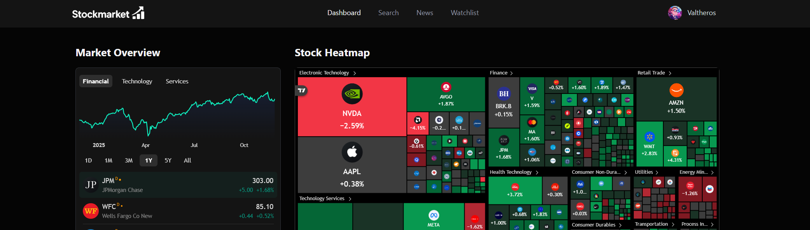

# StockMarket

StockMarket is a mobile-first daily companion for US stocks. Check your watchlist, read your market digest in English or Thai, explore charts, and add the app to your phone's home screen.



## What It Does

- Opens on **Today**: followed stocks (or popular stocks for a new account), latest daily digest, and a market chart/heatmap.
- Refreshes visible stock prices every 60 seconds while the app is online and visible, with manual refresh and explicit unavailable/stale states. Quotes come from Finnhub and are not guaranteed real-time.
- Uses a mobile bottom navigation and compact stock rows, with a wider desktop layout and 20-stock watchlist pages.
- Searches US stocks through Finnhub without waiting for quote/profile checks on every result. TradingView symbols are resolved when opening a stock's detail page.
- Provides stock detail pages with a candle/line chart switch and company, financial, and technical widgets loaded on demand.
- Saves a per-user watchlist in MongoDB and displays USD quotes, daily changes, and provider timestamps. Detailed financials remain available on the stock page.
- Generates personalized daily market news summaries from each user's watchlist using Inngest and Gemini.
- Supports email/password authentication with OTP email verification through Better Auth and Nodemailer.
- Sanitizes AI-generated news HTML before displaying it in the app.
- Supports EN/TH through a persistent cookie and IBM Plex Sans Thai. Missing digests are generated in the background; Thai mode can show a labeled English fallback.
- Installs as a Progressive Web App (PWA) with an offline/retry screen. Account pages, prices, and personalized news are never saved by the service worker.

## Tech Stack

- Next.js 16.3.8 App Router (Turbopack)
- React 19.3
- TypeScript
- Tailwind CSS 4
- shadcn/ui and Radix UI primitives
- MongoDB, Mongoose, and Better Auth
- Finnhub API for stock search, quotes, profiles, metrics, and news
- TradingView embedded widgets for charts and market data
- Inngest for background jobs and scheduled news summaries
- Gemini 3.5 Flash-Lite (`gemini-3.5-flash-lite`) for AI-generated welcome emails and news summaries
- Nodemailer for OTP and welcome emails

## Main Pages

| Route | Description |
| --- | --- |
| `/` | Today: followed stocks, latest digest, and market overview. |
| `/watchlist` | Authenticated watchlist with stock search and enriched market data. |
| `/stocks/[symbol]` | Live-refreshing quote, switchable chart, and on-demand analysis. |
| `/news` | Latest daily digest and any previously stored digests, in the selected language. |
| `/sign-in` | Sign in with email and password. |
| `/sign-up` | Create an account and provide investing preferences. |
| `/verify-email` | Verify account access with an email OTP. |

## Project Structure

```text
app/                     Next.js routes, layouts, and API handlers
components/              Reusable UI, forms, TradingView widgets, and watchlist components
database/                MongoDB connection and Mongoose models
hooks/                   Client-side React hooks
lib/actions/             Server actions for auth, Finnhub, watchlist, users, and news
lib/better-auth/         Better Auth server and client setup
lib/finnhub/             Finnhub environment helpers
lib/inngest/             Inngest client, functions, and AI prompts
lib/nodemailer/          Email transport and templates
lib/tradingview/         TradingView symbol search and matching utilities
public/assets/           App images and icons
tests/                   Node test files
types/                   Global TypeScript declarations
```

## Environment Variables

Create a `.env` file from `.env.example` and fill in the required values.

```bash
cp .env.example .env
```

| Variable | Purpose |
| --- | --- |
| `MONGODB_URI` | MongoDB connection string used by Better Auth, watchlists, rate limits, and news summaries. |
| `BETTER_AUTH_SECRET` | Secret used by Better Auth. |
| `BETTER_AUTH_URL` | Base URL for auth callbacks, usually `http://localhost:3000` locally. |
| `TRUSTED_ORIGINS` | Comma-separated list of allowed origins for Better Auth. |
| `FINNHUB_API_KEY` | Server-side Finnhub API key for stock data and market news. |
| `INNGEST_EVENT_KEY` | Inngest event key. |
| `INNGEST_SIGNING_KEY` | Inngest signing key for verifying requests. |
| `GEMINI_API_KEY` | Gemini API key used by Inngest AI steps. |
| `NODEMAILER_EMAIL` | Email address used to send OTP and welcome emails. |
| `NODEMAILER_PASSWORD` | Password or app password for the Nodemailer account. |

Keep `FINNHUB_API_KEY`, `GEMINI_API_KEY`, and email credentials server-side only.

## Getting Started

Install dependencies:

```bash
npm install
```

Use Node.js 22 LTS or newer (Next.js requires at least Node 20.9; the MongoDB dependencies require a newer supported runtime).

Start the development server:

```bash
npm run dev
```

Open [http://localhost:3000](http://localhost:3000) in your browser.

For local background job testing, connect Inngest to the app's `/api/inngest` route according to your Inngest account setup.

## Install on Your Phone

Use the deployed **HTTPS** URL, sign in, then open **Account > Install app**.

- **Android / Chrome:** tap Install when offered. If no prompt is available, use the browser menu's Install app / Add to Home Screen option.
- **iPhone / Safari:** tap Share, then Add to Home Screen. Enable Open as Web App when offered.
- The installed icon opens StockMarket in its own window. An expired session returns to sign-in.
- Installation controls are hidden inside the installed app. Browser support and install prompts vary.

The service worker runs only in a **production build**. It caches only the bilingual offline screen and app icons, never authenticated HTML, RSC payloads, API responses, stock quotes, or personal news. When offline, opening the app shows a reconnect/retry screen.

`http://localhost` is suitable for desktop checks, but opening a computer's LAN IP over HTTP on a phone does not provide the HTTPS installation environment. Test actual Android/iPhone installation using the deployed HTTPS origin. Set `BETTER_AUTH_URL` and `TRUSTED_ORIGINS` for that origin.

## Price and Digest Updates

- `POST /api/quotes` requires a valid session and JSON `{ "symbols": ["AAPL", "MSFT"] }`. It accepts 1-20 validated symbols, normalizes/deduplicates them, and returns nullable quote values with provider/fetch timestamps and availability status.
- Quote requests share a bounded 60-second server-process cache, deduplicate concurrent symbols, and run at most four upstream requests concurrently per process. Upstream rate limits delay retries. A multi-instance deployment has a separate cache/limit per instance.
- The browser refreshes only displayed symbols and pauses while hidden or offline. It retains previously fetched values with a warning if an update fails.
- Inngest still generates both digest languages on signup and the existing daily schedule. Missing digests can be queued with a deduplicated event. The UI checks every 15 seconds for up to two minutes, then offers another check.
- Existing English documents without a locale are still supported. No data migration is needed. Existing digest storage keeps the latest document per user/language; this release does not backfill historical editions.

## Production and Verification

```bash
npm run lint
npx tsc --noEmit --incremental false
npm test
npm run build
npm start
```

To build separately while a development server is running, PowerShell can set `$env:NEXT_DIST_DIR = '.next-build'` before `npm run build`. Use the same variable for `npm start`, and remove it before normal development. This prevents build artifacts from overwriting the active development output.

For a release, verify 360px, 390px, 768px and desktop layouts in both languages, watchlist changes, search, chart switching, quote refresh/visibility behavior, fallback news, and long-page language skeletons. Verify manifest/icons without signing in, then test installation and offline navigation with a production build. Desktop emulation is not a substitute for actual iPhone/Android installation tests.

Next.js is pinned to the patched 16.3.8 stable release. See the [September 2026 security release](https://nextjs.org/blog/september-2026-security-release) and run `npm audit` regularly; a clean audit describes known advisories at that time, not a permanent guarantee.

At the upgrade check, `npm audit --omit=dev` reports **zero known production vulnerabilities**. The full audit still flags five development dependency entries for a single [braces advisory (CVE-2026-93687)](https://github.com/advisories/GHSA-vfj7-8cjw-p6xm), through the Next.js ESLint plugin. No patched braces release is available yet. Do not use `npm audit fix --force` to downgrade the Next.js ESLint configuration; update the tooling when a compatible fix is published.

## Available Scripts

```bash
npm run dev      # Start the Next.js development server with Turbopack
npm run build    # Build the production app with Turbopack
npm run start    # Start the production server
npm run lint     # Run ESLint
npm test         # Run Node tests
```

You can also run TypeScript checking manually:

```bash
npx tsc --noEmit
```

## Data Flow

1. A user signs up, verifies their email with OTP, and stores investing preferences.
2. The user searches for stocks. US results come directly from Finnhub; search and watchlist status load in parallel. TradingView symbol resolution happens on the stock detail page instead.
3. The user adds symbols to a MongoDB-backed watchlist.
4. The visible stock rows fetch quotes through the authenticated batch API. Company information and financial widgets load separately on stock detail pages.
5. Inngest runs the daily news summary job, fetches news for each user's watchlist symbols, asks Gemini to summarize it, and saves the sanitized result for `/news`.

## Testing Notes

The test suite covers TradingView symbol matching, Finnhub configuration, authenticated quote requests, validation, cache expiry, rate limits, partial failures, refresh eligibility, digest language fallback/authentication, and service-worker offline/cache boundaries:

```bash
npm test
```

These tests help prevent unrelated TradingView search results from being accepted as valid stock symbols.

## Security Notes

- Do not expose private API keys through `NEXT_PUBLIC_` variables.
- AI-generated news HTML is sanitized before rendering.
- Watchlist entries are unique per user and stored with a compound MongoDB index.
- OTP requests use a MongoDB-backed rate limit model.
